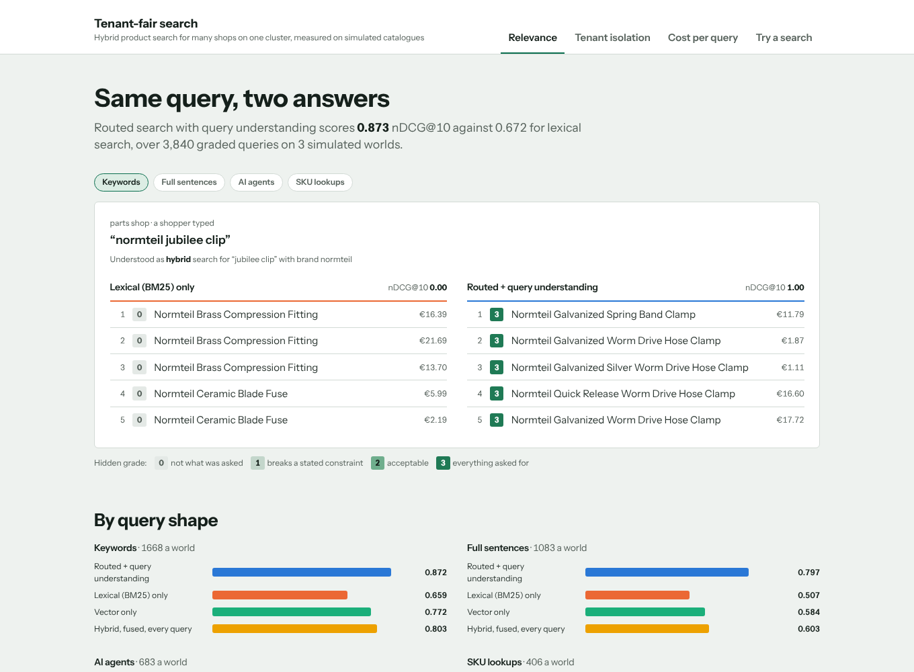

# tenant-fair-search

Multi-tenant hybrid product search in Scala on Elasticsearch. Many shops share one cluster. Their shoppers type
keywords, SKUs and full sentences, and more and more of their traffic comes from AI shopping agents that send
structured constraints and burst. This service decides, for each query, what to retrieve and how: lexical, vector
or fused. It turns "under 120 euros, in navy" into hard filters using only the shop's own catalogue values. It keeps
one shop's agent burst from slowing every other shop. Relevance, latency and the cluster cost of every query are
measured against simulated shops whose truth the service never sees.



## Results

The block below is generated by `python -m tfs.eval.cli` from `reports/*.json`. It is not edited by hand, and CI
fails if it drifts from the reports. The evaluation runs in GitHub Actions against the real service jar and a
one-node Elasticsearch 8.15 cluster.

<!-- results:start -->
<!-- results:end -->

## What is in the box

| Part | Where | What it does |
|---|---|---|
| Search service | `service/` (Scala 3, cats-effect 3, http4s Ember, circe) | `POST /v1/tenants/{t}/search`, bulk indexing, facets, metrics; query understanding (`Parser`), plan selection (`Router`), weighted reciprocal rank fusion (`Fusion`), tenant-scoped request bodies (`Queries`), per-tenant admission (`Gate`) |
| Index | `config/index.json` | One shared index, `_routing` required, BM25 text fields, keyword facets, a 32-dimension `dense_vector` (HNSW, cosine) |
| Term models | `tfs/learn/terms.py` | Per tenant: PPMI and SVD over product text and the words of queries that ended in a purchase; the service embeds with the same tokenizer rule |
| World | `tfs/world/` | Four shops per seed, merchants' and shoppers' vocabularies, keyword, sentence, SKU and agent queries, purchase history, graded truth |
| Evaluation | `tfs/eval/` | Trains, indexes, runs every design on every query, plays a burst against both admission modes, and writes reports, charts, the gate and this README |
| Dashboard | `web/` (React, TypeScript, Tailwind tokens, Framer Motion) | Relevance with real examples graded by the hidden truth, tenant isolation, cost per query, and a live search against your local service |
| Deployment | `Dockerfile`, `deploy/helm/`, `deploy/terraform/` | Service image; chart with probes, PDB, HPA, topology spread and a network policy; Terraform for ECK, the config map built from `config/` and the release |

### The designs

| Design | Lexical | Vector | Query understanding | Routing by shape |
|---|:-:|:-:|:-:|:-:|
| Lexical (BM25) only | yes | | | |
| Vector only | | yes | | |
| Hybrid, fused, every query | yes | yes | | |
| Hybrid + query understanding | yes | yes | yes | |
| Routed, no query understanding | yes | yes | | yes |
| **Routed + query understanding** (default) | yes | yes | yes | yes |

Routing means that SKU lookups go to an exact match without a vector search, that words the shop's model has never
seen go lexical, and that keywords, sentences and agent queries are fused with their own weights. Query
understanding means that price bounds, colour, brand, size and stock become filters, but only values the shop
actually has.

## Run it

```bash
# Elasticsearch 8.15 on :9200 (security off, single node), then:
sbt "service/assembly"
TFS_EVAL_OVERRIDES=true java -jar service/target/scala-3.3.4/tenant-fair-search.jar

pip install -r requirements-dev.txt
python -m tfs.eval.cli smoke        # one world: train, index, every design, a burst
python -m tfs.eval.cli evaluate     # the development worlds; writes reports/ and this README
python -m tfs.eval.cli gate         # config/gate.yaml on reports/dev.json

cd web && pnpm install && pnpm dev  # the dashboard; "Try a search" calls the service
```

```bash
curl -s localhost:8080/v1/tenants/outdoor/search -H 'content-type: application/json' \
  -d '{"query": "looking for a navy raincoat for hiking under 150 euros"}'
curl -s localhost:8080/v1/tenants/outdoor/search -H 'content-type: application/json' \
  -d '{"query": "waterproof rain jacket", "filters": {"maxPrice": 150, "inStock": true}}'
```

`TFS_EVAL_OVERRIDES=true` lets the evaluation choose a design (`X-Design`) and an admission mode (`X-Admission`)
per request. It is off by default and must stay off in production.

## Tests and CI

- `scala`: unit tests for the tokenizer fixture, parser, router, fusion, tenant scoping, token buckets, the embedder; fat jar.
- `python`: the world (determinism, hidden attributes, the vocabulary gap), the term model (learned synonyms, no cross-tenant words), metrics, gate, the README block.
- `e2e`: Elasticsearch as a service container, the jar, one world end to end with every design and a burst.
- `web`: the built dashboard on the committed reports, Playwright with axe on every view, stubbed live search.
- `image`, `infra`: the service image; `helm lint`, the rendered chart through `kubeconform -strict`, `terraform fmt` and `validate`.
- `evaluate` (manual): the full development or held-out evaluation; its artifact holds the reports that are committed.

## Limits

- Every number is about simulated shops. The shops' vocabularies, the share of sentences and agent queries, the
  purchase noise and the burst are assumptions in `config/world.yaml` and `config/catalogue.yaml`.
- The vectors come from a small per-shop model trained on simulated history, not from a pretrained language model.
  The point is the retrieval layer around them: routing, filters, fusion and isolation.
- The latency and capacity numbers come from a shared GitHub runner with a one-node cluster. Compare the two
  admission modes with each other; don't read them as production latency.
- Admission limits are per service replica; across replicas the bucket would need a shared store.
- Query understanding is rules over the shop's own facet values, in English. Other languages need their own phrases
  and analysers.

## Repository guide

`AGENTS.md` has the invariants and the held-out rule. `SKILLS.md` has the repeatable tasks. `docs/adr/` has the
decisions and `docs/runbooks/` the operations.
